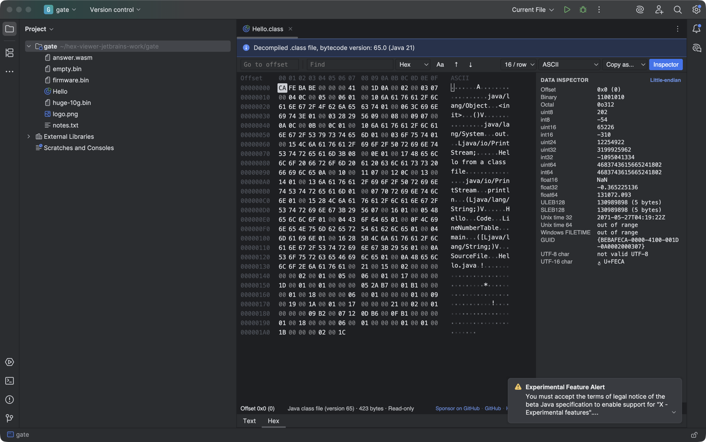

# Hex Viewer & Binary Viewer for JetBrains IDEs

A read-only hex viewer and binary viewer for any file: .bin, .dat, .exe, .dll, .so, .dylib, .o, .class, .wasm, images, firmware dumps and files of 10 GB or more. It runs in IntelliJ IDEA, PyCharm, CLion, GoLand, WebStorm, Rider, Android Studio and the other IDEs on the same platform (2025.2 and later).



## Open a file

- Right-click a file in the Project view, or an editor tab, and pick "Open in Hex Viewer". It works for every file, text and images included.
- Binary files with no editor of their own (.bin, .so, .dylib, .o, .wasm, and .dat files that hold binary data) open in the Hex tab by themselves.
- Files that already have an editor, like a decompiled .class, get a Hex tab next to it at the bottom of the editor.

## What it shows

- offset, hex and ASCII columns, 8 to 64 bytes per row
- a text column in ASCII, Latin-1, UTF-8, UTF-16 LE/BE or EBCDIC
- go to offset: hex (0x1F40), decimal, relative (+0x100, -16) or `end`
- find hex bytes with `??` as any byte, text, or UTF-16 text, forward and backward, with Stop for long searches
- a data inspector for the selected bytes: integers from 8 to 64 bits, floats, LEB128, GUID, Unix time and FILETIME, in either byte order
- copy the selection as hex, a C array, Python bytes, base64 or text
- the file type from its first bytes (PNG, ZIP, PDF, SQLite, Mach-O, Windows PE, WebAssembly and more)

The viewer is read-only. It never writes to the file and makes no network calls. It follows the IDE theme.

## Large files

Only the rows on screen are read, in 64 KB blocks. A 10 GB file opens at once and scrolls to its last byte, and the IDE never loads it into memory. Search reads the file in 1 MB steps and can be stopped at any time.

## How it works

The Hex tab is a JCEF browser. Its page comes from a private origin, `http://zovo-hex/`, which the plugin serves itself (`zovo.jcefshell.ShellScheme`). Nothing goes over the network.

- The page asks for byte ranges: `GET /t/<token>/file?offset=&length=`, at most 64 MB per request. A range past the end of the file gets HTTP 416. The token is random per open tab and is removed when the tab closes.
- Local files are opened for each range and closed again, so the plugin holds no file handle. Files inside JARs (a .class in a library) are read into memory once, up to 256 MB.
- Copy goes back to the IDE clipboard through `POST /t/<token>/copy`. There is no route that writes a file.
- Without JCEF (remote development, some Linux setups) the tab shows the first 4 KB as a plain hex dump.

## Build

The browser bundle is committed in `src/main/resources/web`, so the Gradle build needs no Node.

```
cd web && npm ci && npm run bundle && npm test   # rebuild the bundle, run the JS tests
cd .. && ./gradlew test verifyPlugin buildPlugin  # JDK 21+
./gradlew runIde                                  # sandbox IDE
```

`web/src/hex/core` and `web/src/hex/webview` are copies of the core and webview of [hex-viewer-vscode](https://github.com/theluckystrike/hex-viewer-vscode) 0.1.0, unchanged. `web/test/hex` holds its core tests, unchanged except for the require paths. Only the host side is new: `web/src/hex/shim.js` replaces the VS Code extension host.

## Support and more tools

- [Sponsor on GitHub](https://github.com/sponsors/theluckystrike) if this viewer saves you time.
- [Hex Viewer for VS Code](https://marketplace.visualstudio.com/items?itemName=zovo.zovo-hex-viewer), the same viewer with byte editing.
- [DOCX & PPTX Viewer](https://plugins.jetbrains.com/plugin/35878) opens Word and PowerPoint files in the IDE.
- [NetCDF, HDF5 & NumPy Viewer](https://plugins.jetbrains.com/plugin/35879) opens .nc, .h5, .npy and .npz files.
- All Zovo tools: [theluckystrike on GitHub](https://github.com/theluckystrike).

## License

MIT. Bundled third-party code is listed in [THIRD-PARTY-NOTICES.txt](THIRD-PARTY-NOTICES.txt).
